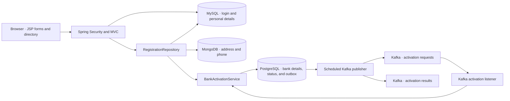

# Banking System Spring

Spring Boot 4.0.5, Java 21+, JSP, Spring Data JPA, Spring Data MongoDB, Spring Security, and Spring for Apache Kafka. Runs on http://localhost:8081 alongside the original banking-system app on 8080.

Retains the registration dashboard and three-step wizard, directory search, editing, delete confirmation, sensitive-field preservation on edit, responsive layout and six themes. Login is required for all registration pages and operations. The header includes a Log out button.

## Architecture

Open the [interactive end-to-end architecture page](docs/architecture.html) in a browser to walk through registration and try the Kafka activation rules with synthetic inputs.

See the [Kafka integration guide](KAFKA_INTEGRATION_README.md) and [database integration guide](DATABASE_INTEGRATION_README.md) for setup, code references, and failure handling.

The Spring Boot application serves the JSP registration dashboard and runs the Kafka producer and consumer in the same process. The browser submits authenticated forms through Spring MVC. `RegistrationController` handles the dashboard, and `PersonController` handles the step-by-step registration routes. Both use `RegistrationRepository` to coordinate persistence.



| Data | Local database | Persistence |
| --- | --- | --- |
| Personal details | MySQL `banking_spring_personal` on 3306 | `PersonalDetailsRepository` / JPA |
| Login accounts | Same MySQL database, `login_accounts` | `LoginAccountRepository` / JPA |
| Address and phone | MongoDB `banking_spring_address` on 27017 | `AddressDetailsRepository` / Spring Data MongoDB |
| Bank details, SSN, and activation status | PostgreSQL `banking_spring_bank` on 5432 | `bank_details` / JPA |
| Pending Kafka events | Same PostgreSQL database | `bank_activation_outbox` / JPA |

Separate entity manager factories and transaction managers isolate MySQL and PostgreSQL. MySQL generates the registration ID shared by all stores. The coordinating service joins the three domain entities into a `Registration` DTO for the UI. The administrator bootstrap flow creates the login account. That administrator can manage all customer registrations.

### Kafka activation flow

1. The registration service saves personal details and the address. The bank service then saves `bank_details.status` as `IN_PROGRESS` and inserts an activation request into the PostgreSQL outbox in the same transaction.
2. The scheduled publisher sends the request to Kafka and removes the outbox row after the broker acknowledges it. If publishing fails, the row stays queued for retry.
3. The listener in the `banking-system-activation` consumer group loads and locks the bank row. It processes the request only when the row is still `IN_PROGRESS` and the request ID matches the latest save. This prevents duplicate or superseded requests from changing the current status.
4. The bank service updates the status to `ACTIVATED` or `FAILED` and inserts a result event in the same PostgreSQL transaction. The scheduled publisher delivers that event to the results topic.

Existing bank rows start at `INACTIVE` until saved.

| Bank | Required prefix |
| --- | --- |
| Bank of America | `9898` |
| Chase | `7878` |
| US Bank | `6868` |

Bank names are matched case-insensitively. A matching account becomes `ACTIVATED`. An unsupported bank or a mismatched
prefix becomes `FAILED`. Refresh the directory to see the updated status.
Saving a corrected registration starts another activation attempt.

Both topics use the customer ID as the Kafka key and carry JSON messages.

| Default topic | JSON fields |
| --- | --- |
| `customer-bank-activation-requests` | `customerId`, `requestId` |
| `customer-bank-activation-results` | `customerId`, `requestId`, `status` (`ACTIVATED` or `FAILED`) |

Messages contain only the fields listed above. If the app stops after Kafka acknowledges a send and before the outbox row is deleted, it may publish the message again. Consumers can deduplicate results by `requestId`.

## Local startup

Start local MySQL, PostgreSQL, MongoDB, and Kafka.

The app connects to Kafka at `localhost:9092` by default. If your Docker broker uses a different host endpoint, set
`KAFKA_BOOTSTRAP_SERVERS` in `.env` and make sure Kafka advertises that endpoint
to host clients. The app creates the topics if they are missing. Override their
names with `KAFKA_ACTIVATION_REQUEST_TOPIC` and `KAFKA_ACTIVATION_RESULT_TOPIC`.

Run the following commands:

```sh
psql -h localhost -U postgres -d postgres -c 'CREATE DATABASE banking_spring_bank;'
cp .env.example .env
# Edit .env with local DB credentials and an initial ADMIN_PASSWORD (12+ characters).
./run.sh
```

For the current workspace, `.env` already contains working local database credentials and a generated administrator password. Open http://localhost:8081/login. Use the `ADMIN_USERNAME` and `ADMIN_PASSWORD` values in `.env`. The file is ignored by Git and readable only by your user.

MySQL creates the new database when the configured user has permission. Hibernate creates/updates the JPA tables; MongoDB creates its collection on the first registration. Existing banking-system data is untouched. If the Homebrew MongoDB service is unavailable, the local MongoDB instance previously started for banking-system can serve both apps using their separate databases.

Configuration overrides: `MYSQL_URL`, `MYSQL_USERNAME`, `MYSQL_PASSWORD`, `POSTGRES_URL`, `POSTGRES_USERNAME`, `POSTGRES_PASSWORD`, `MONGO_URI`, `MONGO_DATABASE`, `PORT`, `ADMIN_USERNAME`, `ADMIN_PASSWORD`. Defaults point to local services. Stop the foreground application with Ctrl+C.

## Login and logout

The administrator is created once if that username does not exist. Passwords are BCrypt hashed in MySQL; `.env` supplies only the initial bootstrap password. Changing `ADMIN_PASSWORD` later does not reset an existing account. To reset a local demo account, stop the app, delete only that username from `login_accounts`, update `.env`, and restart.

Spring Security handles authentication, session fixation protection, and CSRF protection. Every POST form includes a CSRF token. Logout uses POST, invalidates the session, and deletes the app-specific `BANKING_SPRING_SESSION` cookie. Expired or invalid CSRF requests show a readable refresh page and perform no mutation. No default password or public self-signup endpoint is provided.

## Verification

```sh
./mvnw verify
# With ./run.sh active and .env configured, performs synthetic local integration checks:
python3 scripts/verify-local.py
```

Automated tests cover authentication redirects, valid/invalid passwords, CSRF rejection, authenticated saving, logout, persistence mapping, joins, failure compensation, and Kafka activation outcomes including duplicate and superseded requests. The HTTP verification script additionally checks both registration flows, actual records in MySQL/PostgreSQL/MongoDB, edit preservation, deletion and logout. It deletes only the synthetic registrations it creates. The script requires local `mysql`, `psql` and `mongosh` command-line clients and uses the default banking_spring_* database names.

## Consistency and demo limitations

JPA transactions apply individually to each SQL database. They do not form an atomic transaction with MongoDB or the other SQL database. The service attempts compensating repairs on caught write/delete failures and attaches repair errors as suppressed exceptions. Registrations with missing address or bank details can be opened from the directory and completed through Edit. Calls are serialized within one app instance; crashes, failed repairs or multiple app instances still require reconciliation by registration ID. A production system needs durable coordination and concurrency controls.

Account numbers and SSNs retain the original app's plaintext storage, so use synthetic details. This is a local registration demo with login, not a production banking platform.

Implementation references: [Spring Data JPA configuration](https://docs.spring.io/spring-data/jpa/reference/repositories/create-instances.html), [Spring Security form login](https://docs.spring.io/spring-security/reference/servlet/authentication/passwords/form.html), and [CSRF protection](https://docs.spring.io/spring-security/reference/servlet/exploits/csrf.html).
